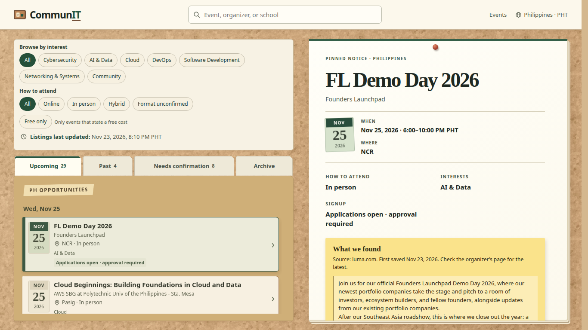
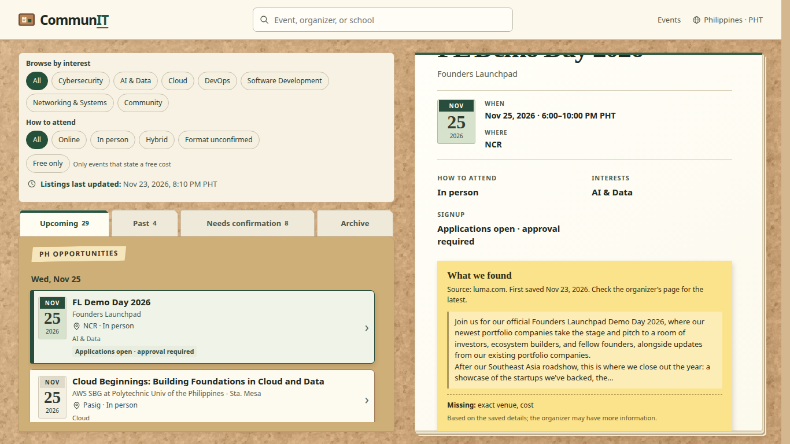
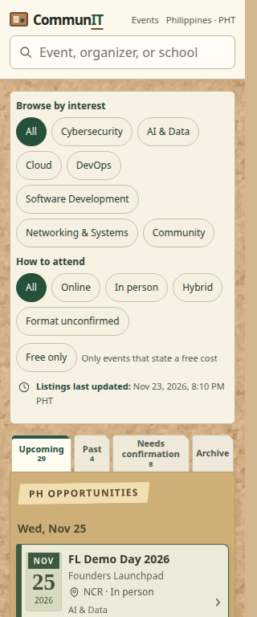

# Board reference completion · November 25, 2026

The user confirmed that the interest and attendance chips in `CommunIT-board-pair.html` should replace the dropdowns. The running preview at **http://127.0.0.1:5173** was checked directly: it already served this checkout, but the previous list-only task had intentionally kept the older filters and notice. No port or startup change was needed.

## Implemented

- Labelled, wrapping interest and attendance chip groups with All, toggle-off, keyboard focus and aria-pressed state. Represented choices stay available while combining filters and sections. Free only includes explicit free/zero-cost records. Clear resets search/topic/attendance/free-only while preserving the selected section.
- A full yellow What we found note with retained prose from the selected event’s fetched organizer page, real source host and valid first-saved date. Missing fields describe gaps in saved event date/time, physical venue, attendance, cost and signup. No fabricated quote, prototype provenance, technical JSON or newly inferred event facts. City-only locations still lack an exact venue; parent dates do not establish the event date.
- The note replaces the small Info we got heading; the remaining facts grid, prominent review notes, date stamps, organizer URL rules and distinct Register action remain.
- Bounded desktop panels with no sticky notice repositioning. Shared native scrollbar styling and independent activity timers hide at idle and reveal for pointer, keyboard, touch or scroll. Stable gutters prevent width changes. Contained scroll overshoot prevents reaching a panel edge from moving the page, including short notices. Mobile retains page scrolling and Back restoration; forced colors retains visible native scrollbars.

## Verification

The final production TypeScript/Vite build and **90/90 Chromium tests passed** in 3.2 minutes: 84 existing checks plus six new regressions. `git diff --check` and all 35 local links in the updated guidance/review files passed. Layout assertions were updated for chip controls and the full note, retaining behavioral coverage.

New checks cover saved source attribution, Manila first-saved day, rejected search-only/unrelated excerpts, city-only versus named venues, missing fields, free/zero/unknown costs, composed chip filtering and clearing at 1366/390/320px, matching scrollbar reveal/idle/gutter/forced-colors behavior, wheel boundaries and short notices. The full suite also retains sticky day handoff, event sorting, desktop selection, mobile Back focus/scroll, uncertainty, precision, distinct links, reduced motion and keyboard navigation.

Saved-API screenshots at 1366×768, 390×768 and 320×768 had no page errors or horizontal overflow. Logs and detailed captures: ignored `data/board-completion/`. Firefox/WebKit and physical devices remain unverified. No backend tests were rerun for this frontend change. No backend/API/schema/source-config changes, collection, main database access, deployment or publishing occurred. Prior local work was preserved; PR #3 still contains the earlier day-grouping work.

Use the existing preview from [RUN_LOCAL](../../../RUN_LOCAL.md), then:

```sh
npm --prefix frontend run build
PLAYWRIGHT_BASE_URL=http://127.0.0.1:5173 npm --prefix frontend run test:e2e
```






