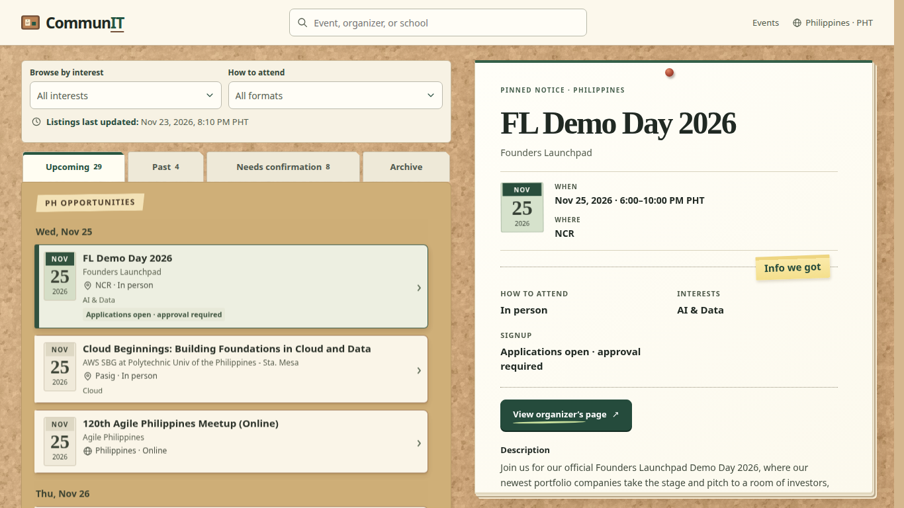
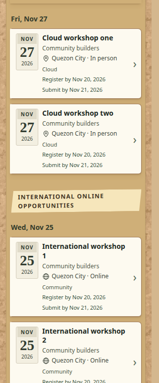

# Sticky event-day groups

Verified November 25, 2026 (Asia/Manila). Interaction reference: the supplied local `CommunIT-board-pair.html`; the Library URL was unavailable. Its native section-bounded sticky behavior was reviewed, without importing its demo content or other UI.

Visible cards are grouped after the existing section, search and filters, within each geography. The existing `eventDay` helper supplies the same Manila day used by the cards and sorting. Same-day order remains stable; unknown/conflicting dates are last under **Date to confirm**. Registration/submission cutoffs never create headings. Each group has a semantic section and heading. Opaque tan headings use CSS sticky positioning within the desktop event-list scroller and the mobile page scroller. No persistent toolbar currently needs an inset.

The navbar, dropdowns, tabs, cards, selection and notice facts/actions remain as implemented before this change. This checkout has **Info we got**, not the prototype's **What we found**/missing-fields note, and has no interest chips. No prototype-only features were added.

## Verification

- Production TypeScript/Vite build passed.
- **84/84 Chromium tests passed** in 2.7 minutes, including four new `day-groups.spec.ts` checks. Existing tests were not weakened or edited for this follow-up.
- At 1366×768, 390×768 and 320×768, three November 25 cards followed by two November 27 cards demonstrate pinned headings, the push-away interval without overlap, and next-heading takeover. A separate geography provides trailing scroll space. Selecting an exposed card preserves desktop list/page position; phone Back restores page position and selected-card focus.
- Verified UTC November 24 at 18:00 appears under November 25 in Manila; date-only and parent-event dates match cards; unknown/conflicting dates remain unresolved. Cutoffs do not set headings. Combined search/attendance/topic filters remove an entire group, empty results leave no groups, and clearing restores groups.
- Full suite retains keyboard navigation, section membership, sorting, mobile Back, long notices, review notes, reduced motion, scrollbar reveal/idle, forced colors and saved-API coverage.
- Saved-API screenshots at all three widths had no horizontal overflow or page errors. `git diff --check` passed.

Build and browser logs, all pin/handoff/takeover captures and saved-data geometry are under ignored `data/day-groups/`. No collection, main-database access, backend/schema/source changes or deployment were performed. The existing preview remains on Vite 5173 and isolated API 5001. Firefox/WebKit and physical devices are unverified; no backend tests were rerun for this frontend-only task.

From the repository root, with the existing isolated preview running per [RUN_LOCAL](../../../RUN_LOCAL.md):

```sh
npm --prefix frontend run build
PLAYWRIGHT_BASE_URL=http://127.0.0.1:5173 npm --prefix frontend run test:e2e
# Focused regression checks:
PLAYWRIGHT_BASE_URL=http://127.0.0.1:5173 npm --prefix frontend run test:e2e -- e2e/day-groups.spec.ts
```

Desktop, normal saved public data:



Phone, normal saved public data:


320px fixture during the heading handoff:


