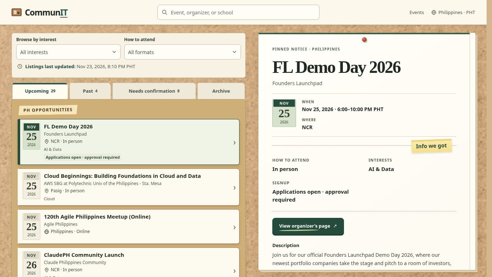
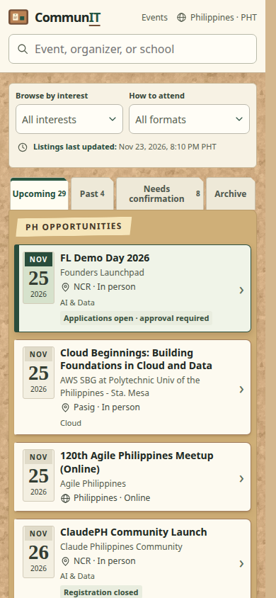
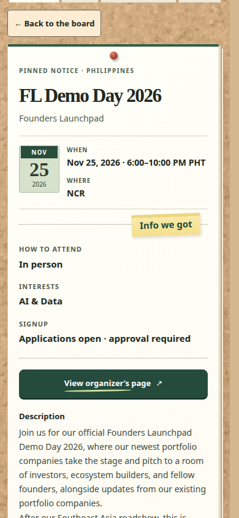

# Put search in the navbar and bring browsing beside the pinned notice

Visitors can search from the navbar and see filters, the first listing and the selected notice together before scrolling at 1366×768. A full-page cork surface replaces the separate green search panel and wooden board frame; a tan folder holds the slightly wider left-hand list, with four level paper tabs and no interest suggestion chips.

The pinned notice retains its date precision, review notes, venue, organizer action and distinct registration link. Desktop notice scrolling remains native, reserves scrollbar space and reveals the thumb during interaction, then hides it after about a second idle. Keyboard focus and forced-colors visibility remain available. Phone Back preserves filters, selection, scroll and focus. The short **All formats** default keeps the attendance control readable at 320px while preserving its existing empty-value behavior.

## Screenshots

## Validation

- Production TypeScript/Vite build passed.
- All **80 Chromium browser tests passed**, including first-screen layout at 1366×768; readable controls/counts and no overflow at 390/320px; composed filtering, empty/clear states and tab navigation; desktop selection stability and mobile Back restoration; long/uncertain schedules, deadlines and links; native scrollbar interaction/idle behavior, reduced motion and forced colors.
- Saved-data desktop/mobile visual checks, changed-document local links and `git diff --check` passed.
- [Desktop and mobile screenshots, reproduction and limits](README.md).

Chromium checks include emulated touch, reduced motion and forced colors. Firefox/WebKit and physical-device testing remain unverified. No app data, API, collector or schema changes are part of this layout; prior local ongoing-event work is preserved separately. AGENTS.md and PROJECT_CONTEXT.md record the resulting layout and checks.

Publication is intentionally pending the user's no-push instruction. Open as a draft and leave it open for review when publishing is authorized.
