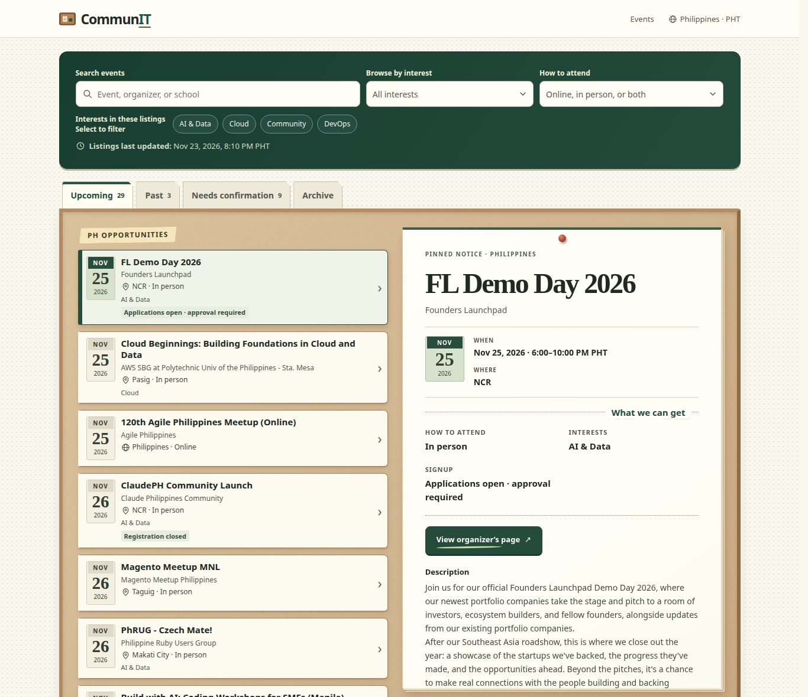
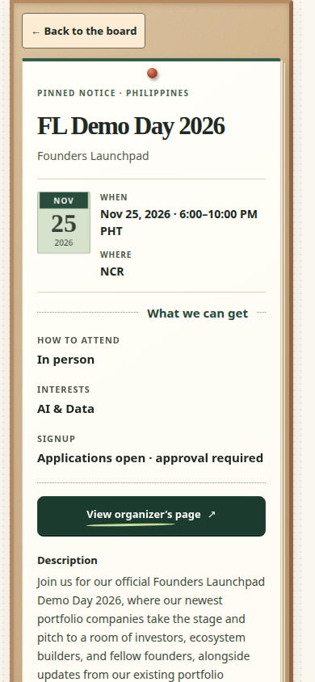

# Pinned-notice redesign review

November 24, 2026, Asia/Manila. Branch: `feat/pinned-notice-redesign`, based on fetched main `b59a003`.

The selected card and pinned paper now share `EventDate`, with a forest-green month strip and one 210 ms press/settle on selection. Important notes remain above the lead containing schedule and venue; street addresses are secondary. Remaining facts keep the existing grid, which disappears when empty. The larger serif title, green paper edge, underlined organizer action and quiet search background follow the **Proposed** notice in the supplied `CommunIT-notice-study.html`. No prototype controls, demo records or simulated organizer dialog enter the app.

Date selection, Manila formatting, parent-event labels, unknown/conflicting dates, deadline semantics, venue evidence and organizer/registration URL selection reuse the existing helpers. The pre-existing browser-title spelling correction to **CommunIT** is retained.

## Screenshots

These show **FL Demo Day 2026** from the existing isolated saved preview through Vite on port 5174, using the normal public API. The preview returned 41 saved records. Counts and freshness reflect that saved snapshot; this review did not reverify publisher pages or collect events.

- [Desktop, 1366 × 1180](desktop.png)
- [Mobile, 390 × 844](mobile.png)





## Verification completed

- Production TypeScript/Vite build passed, writing to ignored `data/pinned-notice/build/` rather than the installed frontend bundle.
- **35 Chromium tests passed** across `pinned-notice.spec.ts`, `notice-details.spec.ts`, `public-notice.spec.ts`, `review.spec.ts` and `campus-board.spec.ts`.
- Long title/address wrapping and no horizontal overflow at 1366, 390 and 320 px; matching card/paper stamp markup, date-only precision and separate registration/submission deadlines.
- Unknown/conflicting dates, prominent review notes, explicitly labelled parent-event schedules and empty remaining fact grids. Schedule and venue appear once in the paper.
- Desktop keyboard selection preserves list nodes/position/scroll and resets paper scroll. Mobile Back restores composed filters, scroll and selected-card focus at 390/760 px.
- One 210 ms stamp animation per selection, including reopening the same selected card on mobile; reduced motion disables animation and hover/press movement. Keyboard focus remains visible.
- Existing venue-evidence exclusions, lifecycle notes, organizer URL preference and distinct Register destinations remain covered.
- Saved-preview rendering produced no page errors. Organizer hover moves up 2 px and pressed state moves down 1 px. Screenshots were visually inspected against the local Proposed reference and long-content fixture captures.
- `git diff --check` and local links in the changed documentation passed.

For the browser checks, all test event records were intercepted API fixtures. The saved-preview screenshot check was separate and read-only. Local build/browser logs, fixture screenshots, reference capture and interaction receipt remain under ignored `data/pinned-notice/`; those files are not guaranteed in a fresh clone.

## Reproduce

Follow [RUN_LOCAL.md](../../../RUN_LOCAL.md) to prepare an isolated saved preview and start the frontend. With dependencies and Chromium installed, from the repository root:

```bash
npm --prefix frontend run build -- --outDir ../data/pinned-notice/build
PLAYWRIGHT_BASE_URL=http://127.0.0.1:5173 \
npm --prefix frontend run test:e2e -- \
  pinned-notice.spec.ts notice-details.spec.ts public-notice.spec.ts \
  review.spec.ts campus-board.spec.ts
```

Use the actual frontend URL: this session used **5174**, with an ignored Playwright configuration pointing to the installed Chromium executable. The commands and preview architecture are otherwise unchanged.

## Limits

Firefox/WebKit, physical devices and the full browser suite were not run. Backend tests were not rerun for this frontend-only change. External organizer destinations were preserved and checked as link attributes; their current content/availability was not reverified. No main database access, live collection, backend/API/schema/source-config edits or deployment occurred.
